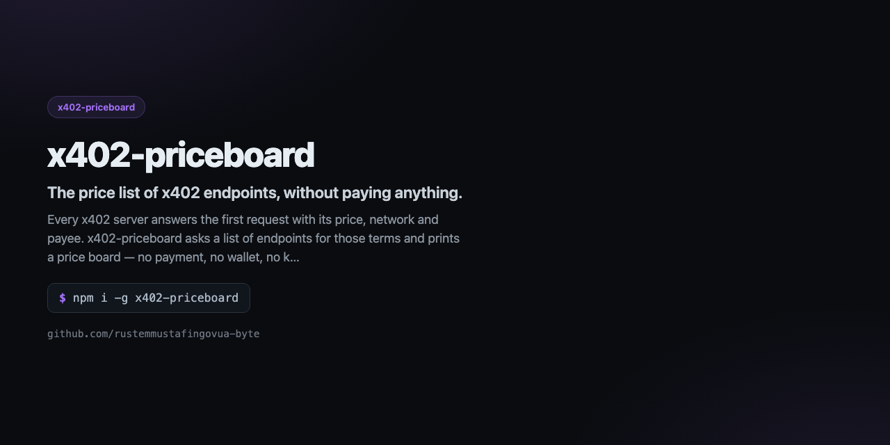

<div align="center">



# x402-priceboard

**The price list of x402 endpoints, without paying anything.**

[](https://github.com/rustemmustafingovua-byte/x402-priceboard/actions/workflows/ci.yml)
[](https://www.npmjs.com/package/x402-priceboard)
[](./LICENSE)
[](https://nodejs.org)
[](https://base.org)

[**Docs**](https://rustemmustafingovua-byte.github.io/x402-priceboard/) · [Issues](https://github.com/rustemmustafingovua-byte/x402-priceboard/issues) · [Discussions](https://github.com/rustemmustafingovua-byte/x402-priceboard/discussions)

</div>

---

Every x402 server answers the first request with its price, network and payee. x402-priceboard asks a list of endpoints for those terms and prints a price board — no payment, no wallet, no key.

## Install

```bash
# tarball из релиза: без токена и без npm-логина
npm i -g https://github.com/rustemmustafingovua-byte/x402-priceboard/releases/download/v0.1.0/x402-priceboard-0.1.0.tgz
```

<details>
<summary>Через GitHub Packages (нужен токен со scope read:packages)</summary>

```bash
npm i -g @rustemmustafingovua-byte/x402-priceboard --registry=https://npm.pkg.github.com
```

</details>
## What it does

| | |
|---|---|
| **Reads the 402 terms** | price, network, asset and payee |
| **Normalises networks** | Base, Ethereum, Solana |
| **Cheapest option per endpoint** | the board sorts by price |
| **Free endpoints too** | a 200 means no payment is needed |


## Usage

```bash
x402-priceboard https://api.venice.ai/api/v1/chat/completions
x402-priceboard --file endpoints.txt --markdown
```

## CLI

```
x402-priceboard — The price list of x402 endpoints, without paying anything.

USAGE
  x402-priceboard https://api.venice.ai/api/v1/chat/completions
  x402-priceboard --file endpoints.txt --markdown

COMMANDS / OPTIONS
  --file <path>  read the endpoint list from a file
  --post         send POST instead of GET when probing
  --markdown     render the board as Markdown

MIT · https://github.com/rustemmustafingovua-byte
```

## Part of a portfolio

| Project | What it does |
|---|---|
| [`opencode-free-stack`](https://github.com/rustemmustafingovua-byte/opencode-free-stack) | route to free models, fall back automatically |
| [`free-web-mcp`](https://github.com/rustemmustafingovua-byte/free-web-mcp) | web search for agents, zero credits |
| [`agent-x402`](https://github.com/rustemmustafingovua-byte/agent-x402) | pay per API call in USDC with a spend policy |

## Donate

MIT, forever. USDC on Base:

```
0x8aC6a229f254980CCd3Dd35CF5E1B7c08880B40E
```

## License

MIT © rustemmustafingovua-byte
